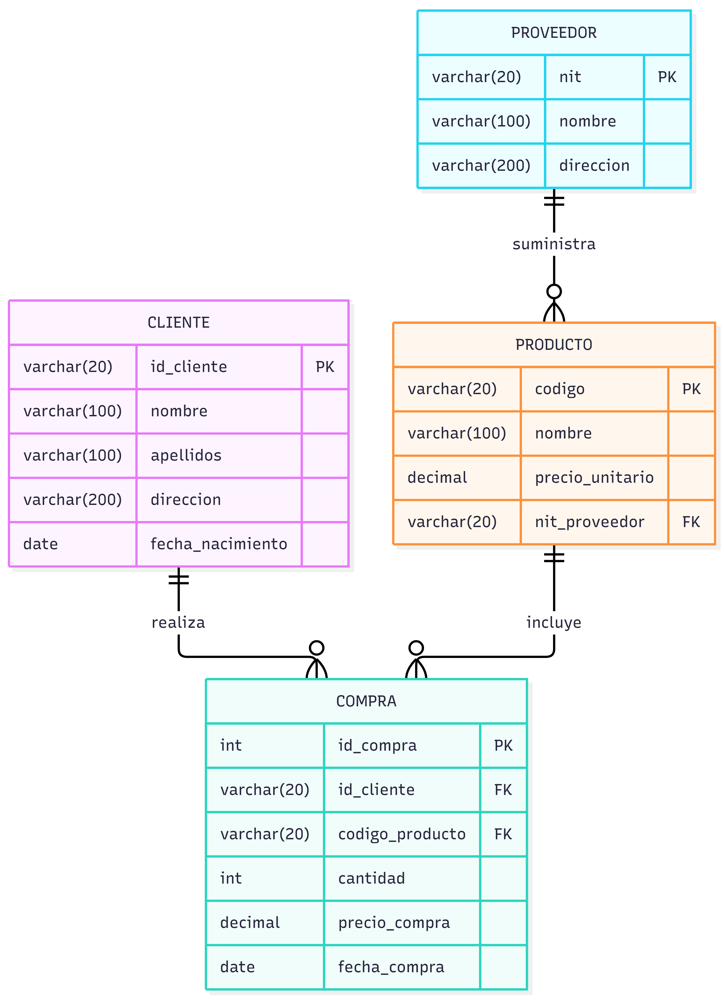

# SalesDB — Laboratorio 01, Bases de Datos

Sistema de gestión de clientes, productos, proveedores y pedidos. Hecho para el Laboratorio 01 del curso de Bases de Datos: modelo entidad-relación, modelo relacional, script SQL y una aplicación web (Express + React) sobre PostgreSQL.

- **App desplegada**: https://sales-db-five.vercel.app
- **API desplegada**: https://salesdb-api.vercel.app (rutas bajo `/api`, por ejemplo [`/api/clientes`](https://salesdb-api.vercel.app/api/clientes))

**Número de grupo: pendiente.** El Word a entregar se llama `LABORATOTIO_1_GRUPO_<#>`.

## Enunciado

Una empresa vende productos a varios clientes. De cada cliente se guarda identificación, nombre, apellidos, dirección y fecha de nacimiento. Cada producto tiene código, nombre y precio unitario, y lo suministra un único proveedor (un proveedor puede suministrar varios productos). De cada proveedor se guarda NIT, nombre y dirección. Un cliente puede comprar varios productos y un producto puede ser comprado por varios clientes.

Entregables:
1. Diagrama entidad-relación.
2. Modelo relacional.
3. Script de creación de tablas, ejecutado en la base del grupo.
4. Aplicación con un menú para:
   - Insertar, actualizar y borrar clientes, productos y proveedores.
   - Que un cliente realice pedidos de productos.
   - Ejecutar 4 consultas:
     1. Clientes y la cantidad de pedidos realizados.
     2. Clientes que no realizaron ningún pedido.
     3. Cliente, producto, cantidad comprada, precio de compra y proveedor.
     4. Proveedores con los productos que suministran.
5. Word `LABORATOTIO_1_GRUPO_<#>`, enviado solo por el líder del grupo.

## Stack

| Capa | Tecnología | Dónde corre |
|---|---|---|
| Base de datos | PostgreSQL | Supabase |
| Backend | Node.js + Express + `pg` | Vercel (función serverless) |
| Frontend | React + Vite + `react-router-dom` | Vercel |

## Diagrama entidad-relación



## Modelo relacional

- `proveedor(nit PK, nombre, direccion)`
- `producto(codigo PK, nombre, precio_unitario, nit_proveedor FK → proveedor.nit)`
- `cliente(id_cliente PK, nombre, apellidos, direccion, fecha_nacimiento)`
- `compra(id_compra PK, id_cliente FK → cliente.id_cliente, codigo_producto FK → producto.codigo, cantidad, precio_compra, fecha_compra)`

El script completo está en [`backend/db/schema.sql`](backend/db/schema.sql).

Decisiones de diseño:
- **`precio_compra` guarda el precio unitario congelado al momento del pedido**, no el total. Si después el producto cambia de precio, los pedidos viejos conservan el precio con el que se compraron. El total (`cantidad × precio_compra`) se calcula en la interfaz, así nunca queda desincronizado si se edita la cantidad.
- **`compra` tiene su propia llave `id_compra`** (no una llave compuesta), para poder editar o borrar un pedido puntual.

## Estructura del repositorio

```
├── backend/
│   ├── api/index.js            # punto de entrada para Vercel (exporta la app de Express)
│   ├── db/
│   │   ├── schema.sql          # creación de tablas (proveedor → producto → cliente → compra)
│   │   └── pool.js             # conexión a Postgres vía DATABASE_URL
│   ├── routes/                 # clientes, productos, proveedores, compras, consultas
│   ├── index.js                # app Express; en local levanta el servidor en :3000
│   ├── vercel.json             # redirige todas las rutas a la función serverless
│   └── .env.example            # plantilla de variables de entorno
└── frontend/
    ├── public/                 # video/imagen de la landing, diagrama ER (basedb.png)
    ├── src/
    │   ├── api/client.js       # llamadas al backend (usa VITE_API_URL)
    │   ├── components/         # NavBar, AppLayout, PageHeader
    │   ├── pages/              # Landing, Dashboard, Clientes, Productos, Proveedores, Pedidos, Consultas
    │   └── index.css           # tokens de diseño y estilos compartidos
    └── vercel.json             # hace que las rutas de React funcionen al recargar
```

## Correr en local

Requisitos: Node.js 20 o superior, y acceso a una base PostgreSQL (la de Supabase o una local).

1. **Base de datos** (solo la primera vez). Ejecuta `backend/db/schema.sql` en tu base:
   - En Supabase: SQL Editor → pega el contenido del archivo **sin** la primera línea (`CREATE DATABASE`) → Run.
   - En Postgres local:
     ```bash
     psql -U postgres -c "CREATE DATABASE salesdb;"
     psql -U postgres -d salesdb -f backend/db/schema.sql
     ```
     (El segundo comando avisa que `salesdb` ya existe; es inofensivo.)

2. **Backend**:
   ```bash
   cd backend
   cp .env.example .env    # y completa DATABASE_URL (ver comentarios dentro del archivo)
   npm install
   npm start               # → http://localhost:3000
   ```

3. **Frontend**, en otra terminal:
   ```bash
   cd frontend
   npm install
   npm run dev             # → http://localhost:5173
   ```

4. Abre `http://localhost:5173`. En local, el frontend llama a `http://localhost:3000/api` por defecto.
   Si `http://localhost:3000` no responde `{"mensaje":"API Laboratorio 01 - Bases de Datos"}`, revisa `DATABASE_URL` en `backend/.env`.

## Variables de entorno

**Backend** (`backend/.env` en local, o "Environment Variables" del proyecto en Vercel):

| Variable | Valor |
|---|---|
| `DATABASE_URL` | Cadena de conexión de Supabase, modo **Transaction pooler** (puerto `6543`). Los caracteres especiales de la clave van codificados (`!` → `%21`). |
| `DB_SSL` | `true` para Supabase, `false` para Postgres local |

**Frontend** (solo en Vercel):

| Variable | Valor |
|---|---|
| `VITE_API_URL` | URL del backend desplegado + `/api`: `https://salesdb-api.vercel.app/api` |

## Despliegue (Vercel + Supabase)

El repo se importa en Vercel como **dos proyectos**:

| Proyecto en Vercel | Root Directory | Preset | Variables |
|---|---|---|---|
| `salesdb-api` (backend) | `backend` | Other | `DATABASE_URL`, `DB_SSL` |
| `sales-db` (frontend) | `frontend` | Vite | `VITE_API_URL` |

El backend usa `backend/vercel.json` para compilar solo `api/index.js` como función y mandar todas las rutas ahí. Sin eso, Vercel publicaría el código de la carpeta como archivos estáticos.

Cada `git push` a `main` vuelve a desplegar los dos. Si cambias `VITE_API_URL`, hay que redesplegar el frontend: la variable se incrusta al compilar.

La conexión a Supabase debe ser la del **Transaction pooler**. La conexión directa solo funciona por IPv6, y Vercel no la alcanza.

Las tablas tienen **RLS activado** sin políticas. Eso bloquea el acceso por la API pública de Supabase, y el backend no se ve afectado porque se conecta como `postgres`. Si se recrean las tablas, hay que volver a activarlo:
```sql
ALTER TABLE proveedor ENABLE ROW LEVEL SECURITY;
ALTER TABLE producto  ENABLE ROW LEVEL SECURITY;
ALTER TABLE cliente   ENABLE ROW LEVEL SECURITY;
ALTER TABLE compra    ENABLE ROW LEVEL SECURITY;
```

## API

Base: `/api`

| Recurso | Rutas |
|---|---|
| Clientes | `GET /clientes`, `GET /clientes/:id`, `POST /clientes`, `PUT /clientes/:id`, `DELETE /clientes/:id` |
| Productos | `GET /productos`, `GET /productos/:codigo`, `POST /productos`, `PUT /productos/:codigo`, `DELETE /productos/:codigo` |
| Proveedores | `GET /proveedores`, `GET /proveedores/:nit`, `POST /proveedores`, `PUT /proveedores/:nit`, `DELETE /proveedores/:nit` |
| Pedidos | `GET /compras`, `GET /compras/:id`, `POST /compras`, `PUT /compras/:id` (cantidad y fecha), `DELETE /compras/:id` |
| Consultas | `GET /consultas/clientes-pedidos`, `GET /consultas/clientes-sin-pedidos`, `GET /consultas/detalle-compras`, `GET /consultas/proveedores-productos` |

Si una llave foránea impide un borrado (por ejemplo, un proveedor que todavía tiene productos), la API responde `409` con un mensaje en español. Datos inválidos o duplicados devuelven `400` o `409`.

## Estado

Hecho:
- [x] Diagrama entidad-relación (`frontend/public/basedb.png`), verificado contra `schema.sql`.
- [x] Script SQL, ejecutado en Supabase.
- [x] Desplegado en Vercel (frontend y backend), con los links arriba.
- [x] Backend: CRUD de clientes, productos y proveedores; crear, editar y borrar pedidos; las 4 consultas.
- [x] Frontend: landing y app con Clientes, Productos, Proveedores, Pedidos y Consultas.
- [x] Confirmación antes de borrar, estados de carga, mensajes de éxito y error, avisos cuando faltan datos previos (por ejemplo, no se puede crear un producto sin proveedores).

Pendiente:
- [ ] Modelo relacional en formato de documento para el Word (el contenido está en la sección "Modelo relacional").
- [ ] Definir el número de grupo y armar el Word con capturas de la app y de las consultas.
- [ ] Probar el flujo completo con datos de prueba (la base está vacía).

## Notas

- El video de fondo (`frontend/public/video.wall.mp4`) y su imagen (`photo.wall.png`) los descargó el estudiante desde motionsites.ai. Si faltan, la landing funciona igual, solo que sin video.
- El favicon usa `frontend/public/photo.wall.png`.
